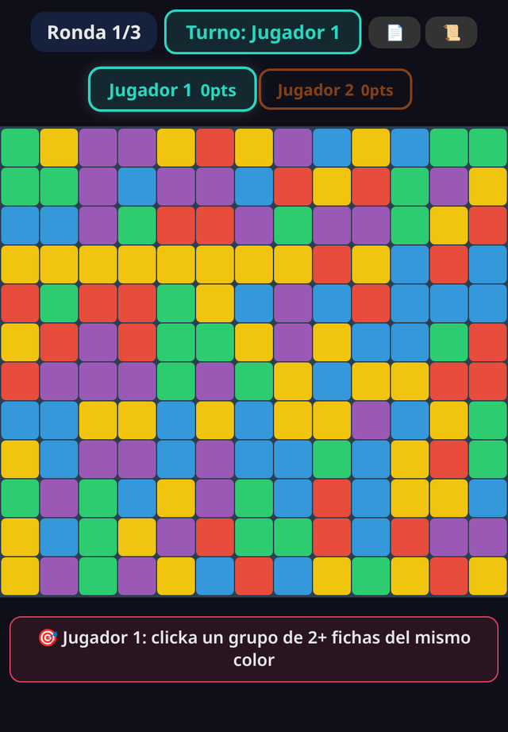

# 💥 Clickomania Party

> Cascadas de colores por turnos en un tablero compartido: tu jugada cambia el tablero de todos. Basado en el paper de NP-completitud de Clickomania.

**[▶ Jugar ahora](https://juliangdeveloper.github.io/clickomania-party/)** · gratis, en el navegador, sin instalar

## Cómo se juega
- 2 a 4 jugadores en un mismo dispositivo; cada puesto puede ser humano o IA (fácil, media o difícil).
- En tu turno haz clic en un grupo de 2 o más fichas del mismo color que se toquen.
- Las fichas desaparecen, las de arriba caen y las columnas vacías se juntan.
- Si al caer se forman grupos de 4 o más, explotan solos en cascada y multiplican los puntos (×2, ×3…).
- Un grupo de N fichas vale (N−1)² puntos; limpiar todo el tablero da +100.
- Gana quien tenga más puntos al terminar las rondas (2, 3 o 5).

## El paper
Clickomania es NP-completo: [Biedl, Demaine, Demaine, Fleischer, Jacobsen y Munro, *The Complexity of Clickomania* (arXiv:cs/0107031)](https://arxiv.org/abs/cs/0107031). El botón 📄 del juego lo resume.

## Stack
Un solo `index.html` con HTML, CSS y JavaScript vanilla. Sin dependencias ni servidor.

## Otros juegos de fiesta
- 🌊 [Flood-It Party](https://github.com/juliangdeveloper/floodit-party) · [jugar](https://juliangdeveloper.github.io/floodit-party/)
- 🔷 [HexaSort Party](https://github.com/juliangdeveloper/hexasort-party-v2) · [jugar](https://juliangdeveloper.github.io/hexasort-party-v2/)
- 🌿 [VidaBalance](https://github.com/juliangdeveloper/vidabalance-v2) · [jugar](https://juliangdeveloper.github.io/vidabalance-v2/)

---

Más proyectos: https://juliangdeveloper.github.io/
